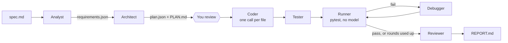

# Architecture

## Pipeline



`python -m crew plan` runs everything left of the review step; `python -m crew build` runs everything right of it; `python -m crew run` does both.

## Principle: code orchestrates, models write

The order of work lives in `crew/orchestrator.py` as ordinary Python. No agent chooses the next step, calls a tool, or talks to another agent directly. Each agent is one stateless chat completion: a system prompt from `prompts/<role>.md` plus a user message the orchestrator assembles.

This is deliberate. Local models handle a narrow, fully specified request ("write this file to this interface") far better than an open-ended tool loop, and a fixed pipeline fails in ways you can read in a log.

## What each agent sees and returns

| Agent | Input assembled by the orchestrator | Output | Format |
|---|---|---|---|
| Analyst | The spec text | `summary`, `requirements`, `acceptance_criteria`, `assumptions`, `open_questions` | JSON, schema-enforced |
| Architect | The Analyst's output (not the spec) | `overview`, `files[]` (`path`, `purpose`, `interface`, `depends_on`), `entry_point`, `dependencies` | JSON, schema-enforced |
| Coder | Summary, requirements, all interfaces, full text of the files this file depends on | One source file | `### FILE:` block |
| Tester | Acceptance criteria, requirements, all source files | Files under `tests/` | `### FILE:` blocks |
| Debugger | Acceptance criteria, interfaces, earlier failed diagnoses, last 6000 characters of pytest output, project files | `DIAGNOSIS:` line and replaced files | `### FILE:` blocks |
| Reviewer | Requirements, criteria, assumptions, test result, final files | `meets_spec`, `gaps`, `notes` | JSON, schema-enforced |

### Two output formats

- **JSON with a schema** for the planning agents. The request carries `response_format={"type": "json_schema", ...}` and LM Studio constrains generation to the schema, so the reply always parses. Schemas are in `crew/orchestrator.py`.
- **Fenced file blocks** for the code agents:

  ````
  ### FILE: pkg/module.py
  ```python
  ...
  ```
  ````

  Code is kept out of JSON because escaping newlines and quotes inside a JSON string makes local models write worse code. `parse_file_blocks` in `crew/workspace.py` extracts the blocks and tolerates chatter around them and fences inside the code.

## Guard rails in the orchestrator

- **Plan validation.** Paths must be relative, inside the project, end in `.py`, and not sit under `tests/`. Duplicates and circular dependencies are rejected. A rejected plan goes back to the Architect with the reason, up to three times.
- **Dependency order.** Files are topologically sorted so every file is written after the files it imports, and the Coder is shown those files in full.
- **Syntax gate.** Every file from the Coder and Tester is compiled before it is written. A syntax error goes back to the agent with the line number, up to three times.
- **Path confinement.** `Workspace.resolve` refuses absolute paths, `..`, and `.venv`. A Debugger reply that tries to write elsewhere has that file ignored.
- **Fix loop memory.** Each Debugger round receives the diagnoses from earlier rounds, labelled as attempts that did not work.
- **Test integrity.** The Debugger's prompt forbids weakening tests, and `REPORT.md` lists every test file it changed so you can verify.
- **Timeouts.** The test run is killed after `test_timeout_s`, and the timeout itself is reported to the Debugger as the failure.
- **Reply truncation.** A reply that stops at `max_tokens` is treated as a failure, not parsed.

## Run folder

```
runs/<spec-name>-<timestamp>/
  requirements.json   Analyst output (editable before build)
  plan.json           Architect output (editable before build)
  PLAN.md             both of the above, readable
  project/            generated package, tests/, requirements.txt
  .venv/              isolated environment for the generated code
  logs/NNN_<role>.md  every prompt and reply, in order
  REPORT.md           test result, reviewer verdict, gaps, fix history
```

## Code map

| File | Responsibility |
|---|---|
| `crew/__main__.py` | Command line |
| `crew/config.py` | Loads `crew.toml` and `prompts/*.md` |
| `crew/llm.py` | OpenAI client pointed at LM Studio; retries, `<think>` stripping, logging |
| `crew/orchestrator.py` | Schemas, pipeline, prompt assembly, plan validation |
| `crew/workspace.py` | Confined file access, file-block parsing, virtualenv, pytest runner |
| `tests/test_pipeline.py` | Pipeline tests using a scripted stand-in for the model |
